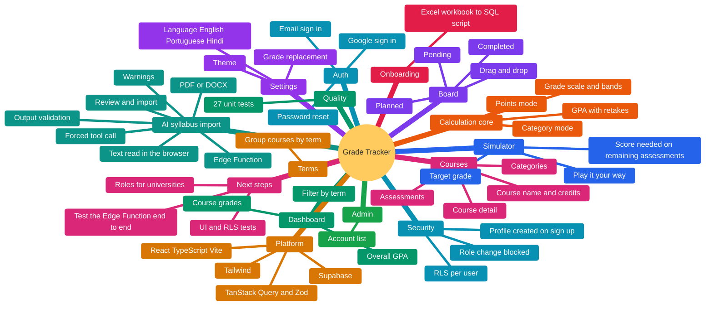
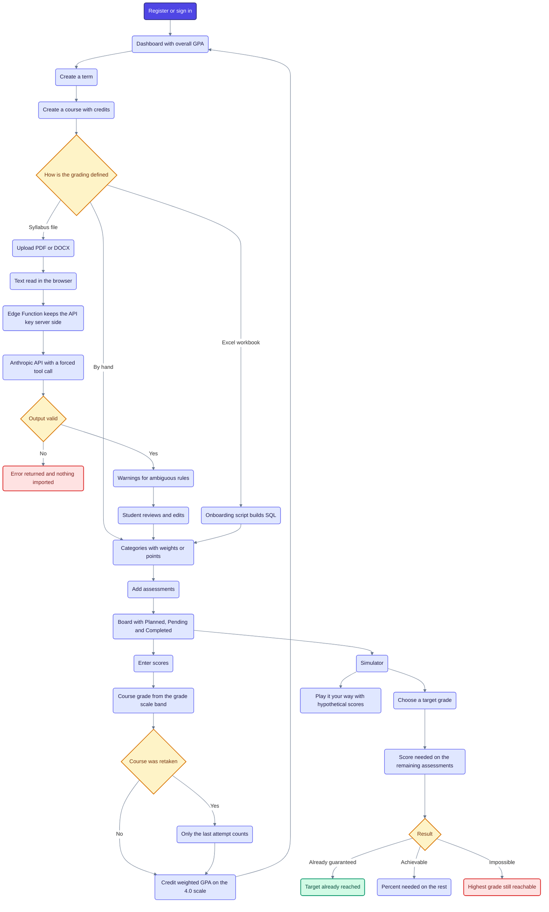

# Architecture

This document explains how ERP Students (Grade Tracker) is built and why. It is written from the code in this repository (`src/lib/calc`, `src/features`, `supabase/`).

## Map

Everything the app contains, by area.



## Flow from start to end

The main path through the app, with its branches. Blue is a step, yellow a decision, green a good end state, orange a state that needs attention, red a blocked or flagged case.



## 1. What the system does

A mobile and tablet friendly web app for university students. A student tracks grades per course, simulates the score needed on upcoming assessments to reach a target grade, and sees a GPA on the US 0 to 4.0 scale. It replaces the Excel templates students use today.

## 2. Big picture

```
 Browser (React SPA)
   |-- reads syllabus files locally ........ pdf.js (PDF), mammoth (DOCX)
   |-- GPA, grading modes, simulator ....... pure functions in src/lib/calc
   |  supabase-js (user JWT)
   v
 Supabase
   |-- Auth ............... users and profiles
   |-- Postgres ........... tables with Row Level Security (data per user)
   '-- Edge Function ...... extract-syllabus -> Anthropic Messages API
```

## 3. Calculation core (`src/lib/calc`)

All grade logic is in pure TypeScript functions with no UI and no network, so it is easy to test.

- **Grade scale (`gradeScale.ts`):** maps a percentage to a band with letter and GPA points, with a default US scale. Students can have their own scale (`grade_scales`, `grade_scale_bands`).
- **Two grading modes:** category mode (weighted categories, `categoryMode.ts`) and points mode (`pointsMode.ts`).
- **GPA (`gpa.ts`):** credit-weighted across courses and terms. When a course is retaken, the retake chain collapses to the most recent attempt (option `onlyLastAttempt`), then the average is taken.
- **Simulator (`simulator.ts`):** given the remaining assessments, computes the score needed to reach a target grade band, and supports "play it your way" with hypothetical scores.

27 unit tests (Vitest) cover the scale, both modes, the GPA and the simulator.

## 4. Data model and security

Tables: `profiles`, `grade_scales`, `grade_scale_bands`, `terms`, `courses`, `categories`, `assessments`. All have Row Level Security, and the typical policy is "all operations only on your own rows" (`auth.uid()`).

- A trigger (`profiles_lock_role`, function `prevent_role_change`) stops users changing their own role.
- A trigger (`on_auth_user_created`) creates the profile when a user signs up.
- `admin_account_list()` is a database function for the admin area.

The schema is a single migration (`0001_init.sql`).

## 5. AI syllabus import (`supabase/functions/extract-syllabus`)

A student uploads a syllabus (PDF or DOCX). The flow:

1. **In the browser**, the file is turned into plain text (`extractText.ts`). Nothing is sent over the network at this step.
2. The text is sent to the **Edge Function**, which keeps the API key server side as a secret (`ANTHROPIC_API_KEY`).
3. The function calls the **Anthropic Messages API** with a system prompt that defines the extraction rules (expand per-item point breakdowns, do not guess weights or dates, put gating rules into warnings) and a **forced tool call** (`record_grading_structure`) with a JSON schema. This makes the model return structured data and not free text.
4. The function **validates the model output** (types, finite numbers, non-empty names) before trusting it, and handles errors separately: invalid request (400), missing configuration (500), network failure (500), API error (502), refusal and unreadable response.
5. Input is limited to 200,000 characters to protect context size and cost.
6. In the UI the student **reviews and edits** the extracted structure before importing it ("Review, tweak, import").

Design choices worth noting: structured output through tool use, validation of everything the model returns, ambiguous rules surfaced as warnings and not invented, and a human review step before data is saved.

## 6. Frontend

React, TypeScript and Vite with feature folders (`courses`, `terms`, `assessments`, `simulator`, `syllabus-import`, `dashboard`, `board`, `admin`, `auth`, `settings`). TanStack Query for data, Zod for validation, react-router for navigation, Tailwind CSS 4, and react-i18next for English, Portuguese and Hindi. The board view uses dnd-kit for drag and drop between Planned, Pending and Completed.

## 7. Onboarding script

`supabase/seed/onboard-student.mjs` builds onboarding SQL from a student's existing Excel workbook, so a student can move from a spreadsheet without retyping everything.

## 8. How it was built

Developed with agentic AI coding (Claude Code), with the calculation core covered by tests.

## 9. Known limitations and next steps

- The Edge Function has not been exercised end to end against the live API in this repository, because it needs the `ANTHROPIC_API_KEY` secret to be provisioned (as noted in the function header). The code is complete, and the model identifier is a constant that should be checked against the current Anthropic documentation.
- CORS on the Edge Function is open (`*`). Supabase's JWT verification should stay enabled so only signed-in users can call it.
- There are no automated tests for the UI or for Row Level Security yet.
- The product is planned to be offered to universities and professors, which would need multi-tenant roles beyond the current per-user model.
